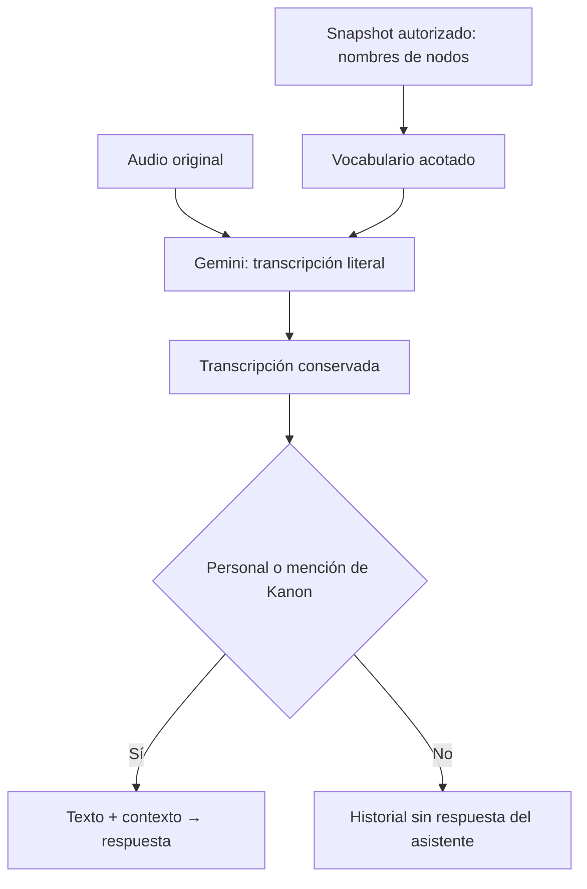

# Transcripción literal con vocabulario del diagrama

## Problema observado

Se reportó que «Kanon, explícame la relación entre pedido y detalle pedido» apareció como
«Canon, explícame la relación entre periodo de y y frecuencia». Durante el cambio inicial
no se disponía de la grabación. Posteriormente el usuario proporcionó el archivo original
y se realizó la comparación real descrita al final de este reporte.

La transcripción previa solo pedía transcribir fielmente en el idioma original, sin vocabulario
del diagrama. Esa etapa es anterior a la generación: si sustituye nombres, el modelo de respuesta
trabaja con una pregunta distinta. La variante «Canon» ya activaba Kanon; no era necesario cambiar
el detector ni reemplazar palabras globalmente.

## Cambio implementado

`app/transcription.py` define instrucciones de transcripción literal y extrae del snapshot
los nombres de nodos, excluyendo notas, atributos, IDs y conexiones. Se limita a 40 términos,
96 caracteres por nombre y 1600 caracteres en total, con deduplicación. «Kanon» se incluye
como nombre del asistente. Los nombres se envían como datos JSON no confiables; no se interpolan
en las instrucciones del sistema.

El proveedor recibe los mismos bytes de audio y MIME, una pista del idioma de interfaz y ese
vocabulario. Se pide conservar lo escuchado, no responder, no completar frases y marcar fragmentos
ininteligibles como `[inaudible]`. El audio tiene prioridad sobre las pistas: no debe inventar
«Pedido» por aparecer en un diagrama. Temperatura cero reduce la variación de generación, pero
no garantiza precisión ni determinismo del reconocimiento.

Las transcripciones de audio mayores de 16000 caracteres se rechazan explícitamente; ya no se
cortan silenciosamente. El caso de uso mantiene el error de turno existente. Las imágenes
conservan su flujo anterior. No cambia el contrato HTTP, las credenciales, el modelo configurado
ni el número de llamadas de generación. El audio continúa procesándose en Google aunque la
respuesta se genere con Qwen.

Las llamadas que usan reconocimiento del navegador producen texto antes de llegar a FastAPI;
esta mejora se aplica a clips y segmentos que llegan como audio, no a ese reconocimiento externo.
No se corrige ni se vuelve a procesar automáticamente el historial ya persistido.

## Verificación

Las pruebas verifican límites, exclusión de notas, bytes/MIME originales, instrucciones,
vocabulario propagado, conservación de la transcripción y activación con «Canon». Usan dobles;
por sí solas no demuestran precisión acústica. La comparación real posterior utilizó el mismo
archivo original en las tres solicitudes, sin regrabar ni convertir el audio. No se cambió a Gemini Live ni a otro modelo de transcripción.

Reiniciar FastAPI si no se usa recarga automática. Ver la
[guía de proveedores](../../guia-desarrollador/04-PROVEEDORES-Y-ENTRADAS-MULTIMODALES.md).

Resultado ejecutado: `UV_CACHE_DIR=/tmp/uml-uv-cache uv run pytest -q`: **77 pruebas aprobadas**.
Se mantienen 65 advertencias de deprecación de terceros (Google GenAI y MongoMock).
Los enlaces relativos de la documentación modificada se comprobaron correctamente.

## Validación con el audio original — 2026-10-28

Se utilizó `350f1e7d-6c02-4b14-9da5-bbc6b4bfd72b.webm`: 64 664 bytes,
4,116 segundos, Opus a 48 kHz, dos canales. FFmpeg lo decodificó sin reportar errores.
Se enviaron los mismos bytes a `gemini-2.5-flash` mediante la configuración existente de
FastAPI. No se escribió en MongoDB, PostgreSQL ni en el historial del chat.

| Prueba | Transcripción real | Tiempo de la solicitud |
| --- | --- | --- |
| Instrucción anterior | Cano, explícame la relación entre pedido y gallina, por favor. | 2.896 s |
| Actual, sin nombres del diagrama | Kanon, explícame la relación entre pedido y detalle pedido. | 1.796 s |
| Actual, con nombres de ejemplo Pedido / DetallePedido | Kanon explícame la relación entre pedido y detalle pedido | 2.043 s |

El resultado con la instrucción actual coincide en contenido con la frase esperada por el
usuario, incluso sin incluir Pedido/DetallePedido como pistas. La tercera prueba usa nombres
aportados como ejemplo, no un snapshot recuperado del diagrama del usuario.

La instrucción anterior produjo otro error semántico («gallina»), distinto del error original
reportado («periodo / frecuencia»). No se trata de una reproducción determinista de aquel fallo.
Son tres solicitudes sobre un solo archivo, no una evaluación de precisión general ni un
benchmark de latencia. Los tiempos incluyen la comunicación con el proveedor. La mejora
queda comprobada para estas ejecuciones; otros audios o nuevas ejecuciones pueden variar.

Huella SHA-256 del archivo probado: `0f3c5874daa28ea4c38b4120069ed56c475d48a82d8ee40460457b87ff6be5d0`.
El archivo de audio permanece en su ubicación original y no se incorporó al repositorio.
