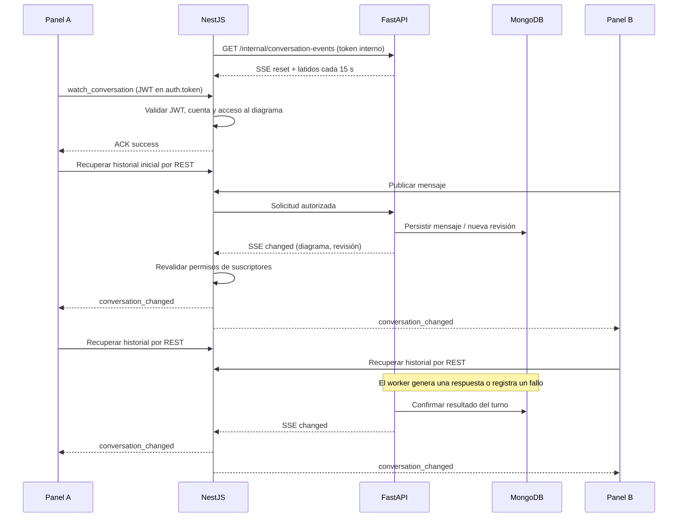

# Sincronización del chat mediante avisos

## Cambio implementado

El panel recupera el historial al abrir, cuando recibe un aviso de cambio y, como respaldo,
30 segundos después de cada recuperación exitosa mientras la pestaña está visible. Antes
consultaba cada 1,5 segundos incluso sin actividad. En una sala inactiva esto reduce las
consultas periódicas aproximadas por panel de 40 a 2 por minuto. No es una medición de carga:
el tráfico real también depende de mensajes, errores, reconexiones y duración de peticiones.

Al ocultar la pestaña se pausa la consulta automática de historial. Al volver se recuperan
los cambios. Cerrar el panel o cambiar de diagrama libera solicitudes, temporizadores y
suscripción Socket.IO del chat. El socket de colaboración del lienzo sigue siendo independiente.

## Recorrido completo



## Responsabilidades

| Componente | Responsabilidad |
| --- | --- |
| [ConversationEvents](../../app/events.py) | Difusión interna SSE por proceso, colas de 256 avisos y recuperación ante desborde. |
| [ConversationRepository](../../app/repository.py) | Notificar solo después de escrituras confirmadas, sin modificar la respuesta si falla el aviso. |
| [AiServiceClient](../../../backend/src/modules/conversations/ai-service.client.ts) | Consumir SSE con autenticación interna, límite de búfer y vigilancia de latidos. |
| [ConversationEventsService](../../../backend/src/modules/conversations/conversation-events.service.ts) | Una conexión interna compartida por proceso NestJS y reconexión con demora creciente. |
| [ConversationGateway](../../../backend/src/modules/conversations/conversation.gateway.ts) | Autorizar suscripciones y emitir metadatos a participantes que conservan acceso. |
| [ConversationRealtimeService](../../../frontend/src/app/plugins/ai-assistant/conversation-realtime.service.ts) | Adaptar Socket.IO al plug-in sin añadir tipos concretos al Core. |
| [ConversationStateService](../../../frontend/src/app/plugins/ai-assistant/conversation-state.service.ts) | Recuperación por avisos, deduplicación, paginación, respaldo y pausa al ocultar pestaña. |

## Contratos

### FastAPI → NestJS

`GET /internal/conversation-events`, con `x-ai-service-token`, devuelve `text/event-stream`.
El flujo comienza con `{"type":"reset"}` y entrega cambios como:

```json
{"type":"changed","diagramId":"505dc0a9-8dd4-407c-b895-7ff8354ba5a0","revision":8}
```

Las tramas SSE son `data: <JSON>` seguidas de dos saltos de línea. Los comentarios
`: keepalive` aparecen cada 15 segundos sin consultar MongoDB. Desbordar la cola sustituye
sus avisos por un `reset`; el historial durable permite recuperar el estado.

El puente valida el formato y acepta solo sala/revisión o reset. Limita su búfer de texto a
64 KiB y corta una conexión que no entrega datos durante 45 segundos. La reconexión espera
1, 2, 4… hasta 30 segundos; una conexión que vuelve a entregar eventos reinicia esa demora.
El flujo no utiliza el timeout de 15 segundos de las peticiones HTTP normales.

### NestJS → navegador

El namespace `/conversations` usa el servidor Socket.IO ya disponible. El cliente entrega el
JWT en `auth.token` y solicita `watch_conversation` con `{diagramId}`. El ACK confirma
`{success: true}` únicamente después de validar firma, caducidad, cuenta activa y acceso al
recurso. Una conexión puede observar una sola sala. El cuerpo no decide la identidad del usuario.

`conversation_changed` entrega `{diagramId, revision}`. Sin revisión significa que se debe
resincronizar después de una reconexión interna o desborde. Se vuelven a comprobar permisos y
vigencia de la sesión antes de notificar. Un acceso revocado retira la suscripción y produce
`conversation_unavailable`. `unwatch_conversation` o la desconexión la cancelan, incluidas
operaciones de autorización que aún no hayan terminado.

Los avisos no contienen mensajes, AST ni adjuntos. Esos datos se obtienen por REST y se vuelven
a autorizar allí. El namespace `/collaboration` del lienzo conserva su protocolo; la validación
del chat no corrige ni sustituye las limitaciones previamente documentadas de ese otro canal.

## Recuperación y recursos

- El frontend agrupa avisos durante 150 ms, ignora revisiones antiguas y no inicia ciclos
  automáticos simultáneos. Un aviso recibido durante una consulta se recupera al finalizar.
- Cada reconexión Socket.IO repite la suscripción; su ACK provoca una lectura del historial.
  El catálogo se consulta una vez al abrir, sin recargarlo por cada aviso.
- El respaldo HTTP de 30 segundos permite recuperar cambios aunque falle SSE o Socket.IO.
  Los fallos HTTP de historial/catálogo esperan 4, 8, 16… hasta 60 segundos.
- Las pestañas ocultas conservan el canal de avisos, pero suspenden la recuperación automática
  del historial. Al volver se actualizan. Las peticiones ya iniciadas pueden terminar.
- Una respuesta tardía de otro diagrama se descarta. La paginación recupera huecos y actualiza
  estados ya visibles; IDs, secuencias y deduplicación conservan el contrato existente.
- Los avisos cubren aceptación, procesamiento, respuesta, fallo, reintento y aplicación de
  propuestas. Leer historial, resumir memoria o generar audio no crea avisos por sí mismo.
- FastAPI mantiene un worker de turnos con su ciclo existente de consulta de trabajo pendiente.
  Esta mejora elimina el sondeo frecuente desde los paneles; no sustituye ese worker.

## Activación y despliegue

Reiniciar **FastAPI y NestJS** y recargar el frontend con esta versión. No hay nuevas variables
de entorno, dependencias ni migraciones. Se reutilizan `AI_SERVICE_URL`, `AI_SERVICE_TOKEN`,
JWT y la dirección Socket.IO configurada. Se puede actualizar FastAPI, después NestJS y por
último frontend; los clientes anteriores continúan usando las rutas REST existentes.

Un proxy entre NestJS y FastAPI debe permitir streaming sin buffering y mantener la conexión
entre latidos. Un proxy del navegador debe permitir Socket.IO en `/socket.io/`; `/conversations`
es un namespace, no una ruta WebSocket HTTP adicional. Se conserva el transporte de respaldo
de Socket.IO cuando no esté disponible WebSocket.

La conexión interna se mantiene abierta por proceso NestJS aunque no haya paneles abiertos.
Los latidos no generan peticiones GET nuevas ni invocan modelos. La ausencia de una línea de
access log final para un SSE todavía abierto no significa que falte la conexión.

### Límite al distribuir procesos

Los avisos FastAPI son locales al proceso: no son una cola durable ni un broker compartido.
Con **un proceso FastAPI**, los procesos NestJS conectados a él reciben sus cambios. Con varios
workers/réplicas FastAPI, una conexión recibe los cambios del worker que la atiende; el respaldo
HTTP recupera los demás con mayor latencia. Para garantizar difusión inmediata entre múltiples
réplicas se requiere un transporte compartido, por ejemplo un broker o change streams bajo
una topología MongoDB compatible, con pruebas específicas. Esta implementación no afirma esa
garantía ni entrega exactamente una vez.

## Verificación de esta implementación

Ejecutado el 26 de octubre de 2026:

| Área | Resultado |
| --- | --- |
| Frontend: `npm test -- --watch=false` | 26 archivos, 168 pruebas exitosas; incluye verificaciones de arquitectura. |
| Frontend: `npm run build` | Compilación de producción correcta. |
| Backend: `npm test -- --runInBand` | 26 suites, 200 pruebas exitosas. |
| Backend: `npm run build` | Compilación correcta. |
| FastAPI: `uv run pytest -q` | 67 pruebas exitosas; 61 advertencias de deprecación de Google SDK/MongoMock. |
| Transporte local FastAPI → NestJS → Socket.IO | Dos participantes recibieron avisos y la respuesta asíncrona; otra sala quedó aislada y un JWT inválido fue rechazado. |

Las suites cubren autorización, revocación, cambios de sala, reconexión, cola saturada,
publicación posterior al commit, lectura SSE fragmentada, espera creciente, revisiones duplicadas,
pestañas ocultas, ausencia de consultas simultáneas y recuperación de páginas.

La prueba local usó Uvicorn y NestJS/Socket.IO reales sobre puertos temporales, JWT firmado
sintético, MongoMock, repositorios de autorización sustituidos y un proveedor de respuestas
simulado. No consumió Vertex, Qwen ni bases reales. No equivale a una prueba de carga,
distribución entre réplicas o validación contra PostgreSQL/MongoDB reales.

## Comprobación manual

1. Abrir el mismo diagrama con dos usuarios autorizados y abrir ambos paneles.
2. Enviar un mensaje y comprobar que aparece en ambos sin esperar la comprobación de respaldo.
3. Consultar a IA y observar estados y respuesta del turno; probar también un fallo/reintento.
4. Dejar el chat sin actividad: las lecturas de historial deben espaciarse aproximadamente
   30 segundos, además de la carga inicial y avisos por cambios reales.
5. Ocultar la pestaña: no deben comenzar nuevas lecturas automáticas de historial. Volver y
   comprobar recuperación de mensajes que llegaron mientras estaba oculta.
6. Cerrar el panel: deben detenerse sus consultas y su suscripción. Interrumpir/reponer la red
   y comprobar recuperación, sin mensajes duplicados ni datos de otra sala.
