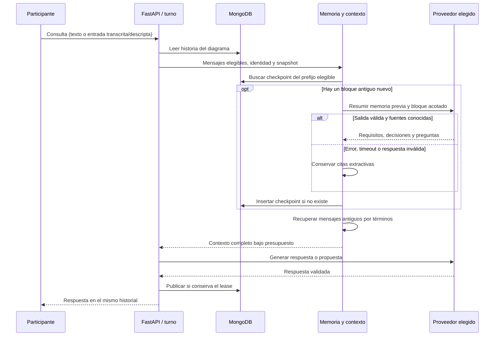

# Memoria persistente del chat grupal

## Resultado

El asistente combina una ventana de mensajes recientes, una memoria resumida persistente y
mensajes antiguos relevantes recuperados por texto. La unidad de memoria es el **diagrama**,
compartido por sus participantes autorizados. Cambiar entre Qwen y Vertex mantiene esa historia.
La memoria no se comparte entre diagramas ni representa una memoria global del usuario.

El alcance está contenido en FastAPI. Los contratos HTTP, permisos NestJS, historial visible,
IDs y aplicación revisada del AST conservan su comportamiento. No requiere nuevos paquetes,
una base vectorial, otro modelo local ni cambios en el panel Angular.

## Flujo



## Componentes

| Archivo | Responsabilidad |
| --- | --- |
| [memory.py](../../app/memory.py) | Elegibilidad temporal, búsqueda léxica, resumen incremental, citas y checkpoints MongoDB. |
| [context.py](../../app/context.py) | Ensamblar las tres capas dentro del presupuesto, manteniendo snapshot y pregunta completos. |
| [providers/models.py](../../app/providers/models.py) | Resumen estructurado con el proveedor elegido; sin generación de AST en esta operación. |
| [conversations.py](../../app/conversations.py) | Orquestar memoria inyectada y generación bajo el lease existente. |
| [main.py](../../app/main.py) | Componer las dependencias durante el arranque; no inferir al abrir el panel. |
| [config.py](../../app/config.py) | Validar límites de contexto, ventanas, bloques y timeout. |

## Activación y configuración

Reiniciar FastAPI con MongoDB disponible y el entorno existente:

```sh
cd ia
uv run uvicorn app.main:create_app --factory --host 127.0.0.1 --port 8000 --reload
```

No es necesario modificar `.env`: los ajustes nuevos tienen valores predeterminados.
Se pueden personalizar exclusivamente en `ia/.env`:

```dotenv
CHAT_CONTEXT_CHARS=48000
CHAT_RECENT_MESSAGES=12
CHAT_MEMORY_BATCH_MESSAGES=12
CHAT_RETRIEVAL_MESSAGES=4
CHAT_MEMORY_TIMEOUT_SECONDS=20
```

Con estos valores, una consulta con 24 mensajes anteriores completados ya puede generar el
primer resumen de 12. El siguiente aparece cuando otro bloque de 12 pasa fuera de la ventana
reciente. Las respuestas del asistente cuentan como mensajes. Antes del primer resumen, los
mensajes fuera de la ventana reciente ya pueden recuperarse por coincidencia de términos.
`CHAT_RETRIEVAL_MESSAGES=0` desactiva esa recuperación, sin borrar memoria ni historial.

La colección `conversation_memory` se crea al guardar el primer checkpoint. La cuenta MongoDB
debe poder leer y actualizar/insertar en ella. No hay migración destructiva ni reconstrucción
masiva en el arranque. Las conversaciones previas se incorporan progresivamente al consultar IA.
Los mensajes de equipo, clips transcritos y descripciones de imágenes forman parte del contexto.
Escuchar una respuesta con Edge TTS no crea otra entrada ni actualiza el resumen.

## Aislamiento y recuperación

Cada checkpoint es inmutable y su hash incluye sala y fuentes ordenadas. Un turno reintentado
solo puede leer checkpoints derivados de sus mensajes elegibles, aunque ya exista una memoria
más nueva. Los mensajes pendientes/fallidos y humanos posteriores al turno quedan fuera.
Las respuestas completadas a preguntas anteriores se admiten mediante `replyTo`.

Las citas incluyen IDs de origen; al construir contexto se agrega la autoría original. La
memoria puede indicar requisitos, decisiones, restricciones o preguntas abiertas, pero no
constituye confirmación de que un cambio fue aprobado o aplicado. El prompt trata tanto los
resúmenes como los mensajes recuperados como datos no confiables y derivados.

Si falla la inferencia del resumen, se conservan citas literales acotadas y se continúa con
la generación de respuesta. Un checkpoint extractivo se reutiliza igual que otro; no provoca
reintentos continuos del resumen. Si falla la persistencia de memoria, el turno sigue usando
ventana reciente y recuperación. El historial original continúa siendo la fuente de verdad.

## Coste y límites

- Como máximo una solicitud adicional de resumen por turno con bloque nuevo; no una por mensaje
  ni una por cada bloque al incorporar una conversación antigua. Puede repetirse tras una caída.
- Entrada del resumidor: memoria previa y hasta 12 mensajes, con extractos de 800 caracteres.
  Salida: hasta 12 elementos de 240 caracteres y hasta tres fuentes por elemento.
- Contexto de respuesta: presupuesto de caracteres del JSON completo, con identidad, pregunta y
  snapshot intactos. El prompt de sistema tiene tamaño adicional; no es un presupuesto de tokens.
- Distribución inicial del espacio libre: mitad para recientes, un cuarto para resumen y un
  cuarto para recuperación. El sobrante admite más entradas de la ventana reciente. Las citas
  pueden recortarse de forma explícita; nunca se recorta silenciosamente el AST.
- La búsqueda compara palabras sin tildes ni mayúsculas, ponderadas por frecuencia. **No es
  búsqueda semántica**: sinónimos y preguntas vagas pueden no recuperar lo esperado.
- Los resúmenes pueden omitir matices o contener interpretaciones incorrectas. Las citas ayudan
  a rastrear procedencia, pero no demuestran que la interpretación del modelo sea correcta.
- El historial mantiene sus límites anteriores (capacidad cercana a 1000 mensajes y 12 MB).
  Los checkpoints no tienen TTL ni sustituyen una política de archivado o retención.
- Los metadatos de tokens de una respuesta no suman el consumo de su resumen. No se afirma
  una sola inferencia/cobro ante recuperación de un worker.

## Verificación

Ejecutar desde `ia/`:

```sh
uv run pytest -q
```

La suite incluye presupuesto serializado, recuperación de términos antiguos, procedencia,
reutilización tras reinicio, aislamiento entre salas, reintento antiguo ante memoria futura,
inmutabilidad, adopción de historial largo, fallos de resumen/caché y composición al arrancar.
Los adaptadores Ollama y Google se prueban con respuestas sustituidas, incluyendo esquema y
timeout. Se conserva la cobertura existente de conversación, propuestas y síntesis de voz.

Las pruebas usan MongoMock y proveedores simulados. No certifican conectividad real a MongoDB,
precisión semántica del resumen, latencia de Qwen ni autorización/cuota de Vertex.

Resultado de esta implementación (23 de octubre de 2026): `uv run pytest -q` completó
**62 pruebas exitosas**. Se observaron 61 advertencias de deprecación de dependencias:
Google Gen AI SDK y MongoMock bajo Python 3.14. Se comprobaron los enlaces locales de las
guías y los docstrings de los métodos nuevos. No se modificaron contratos públicos ni se
ejecutaron suites Angular/NestJS para este cambio interno de FastAPI. No se consumieron
proveedores reales durante esta verificación.

Comprobación manual sugerida en un diagrama de prueba: registrar un requisito concreto,
continuar hasta superar la ventana reciente y consultar por sus palabras clave. Verificar que
el contexto recupera el requisito y conserva al autor. Reabrir la aplicación y comprobar que
el checkpoint se reutiliza; repetir en otro diagrama para verificar que no comparte memoria.

Ver también [contexto y turnos](../../guia-desarrollador/02-CONVERSACIONES-CONTEXTO-Y-TURNOS.md),
[persistencia](../../guia-desarrollador/03-PERSISTENCIA-MONGODB-Y-RECUPERACION.md) y
[proveedores](../../guia-desarrollador/04-PROVEEDORES-Y-ENTRADAS-MULTIMODALES.md).
