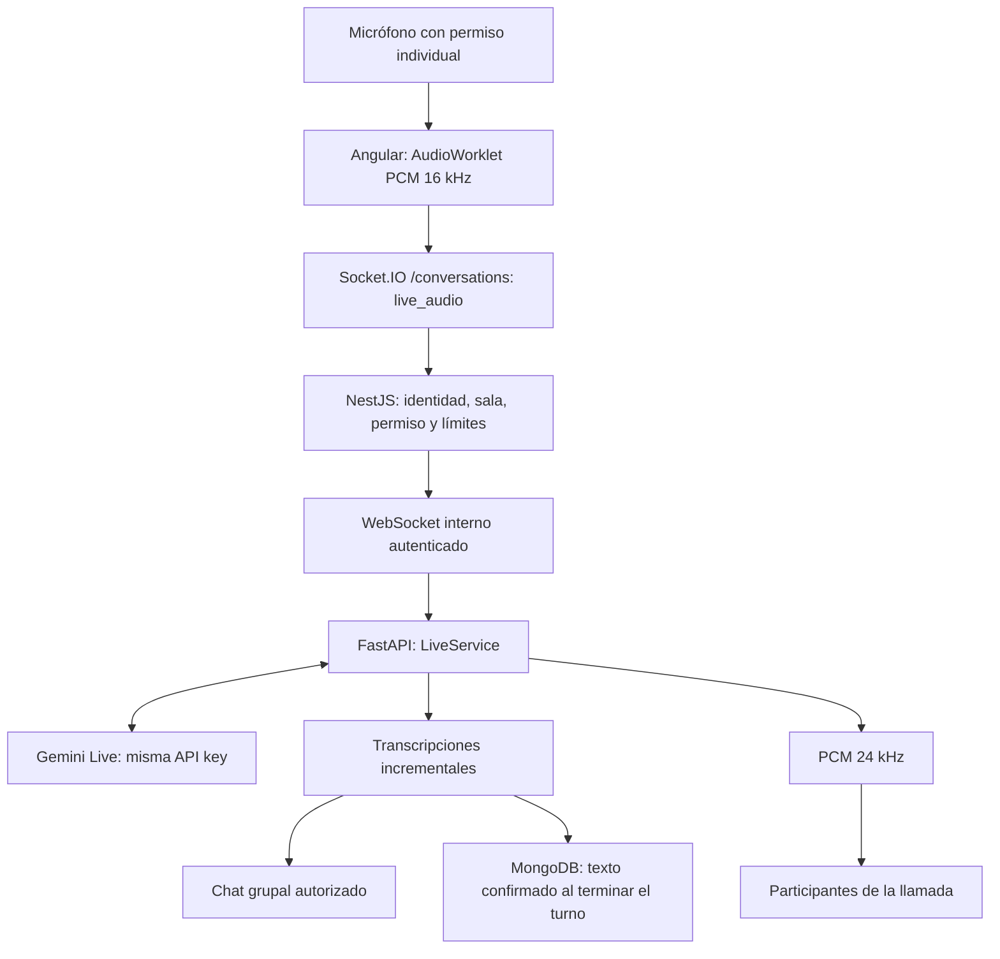

# Gemini Live y entradas multimodales de Kanon

## Resultado

Se incorpora audio nativo bidireccional a la llamada grupal y se optimizan las consultas con
adjuntos. El código permanece dentro del plug-in Angular, el módulo de conversaciones NestJS y
los adaptadores/casos de uso FastAPI. Las credenciales Google continúan exclusivamente en `ia/.env`.

| Entrada | Procesamiento |
| --- | --- |
| Texto | Proveedor seleccionado: Qwen o Gemini. |
| Imagen con invocación / Personal | Gemini recibe imagen original, texto y contexto; devuelve descripción y respuesta juntas. |
| Clip con `@Kanon` escrito / Personal | Gemini recibe audio original, texto y contexto; devuelve transcripción y respuesta juntas. |
| Clip Grupal sin mención escrita | Primero transcripción para detectar Kanon; si se lo invoca, Gemini responde usando también el audio original. |
| Llamada autorizada | Gemini Live recibe PCM continuamente mientras el micrófono está habilitado; devuelve audio nativo y transcripciones. |

En Grupal, adjuntar una imagen no constituye por sí solo una invocación. La indicación de medios
cloud en el compositor explica que Qwen no procesa imágenes ni audio. La actualización de memoria
del chat puede hacer una inferencia adicional por bloque; «una solicitud» se refiere al procesamiento
del contenido multimedia y su respuesta, sin separar transcripción y razonamiento.

## Flujo de la llamada

La sesión está asociada al micrófono de un participante, sin mezclar identidades. Otros participantes
pueden escuchar a Kanon sin autorizar su propio micrófono a Google. Para hablar directamente con
Kanon necesitan consentir. Los usuarios fuera de la llamada reciben texto en el chat, no audio.
La invocación durante Live es una instrucción al modelo; no es una puerta determinista por palabra
clave ni evita enviar a Google el resto del audio autorizado. La interfaz comunica ese alcance.

El modelo recibe el snapshot autorizado al abrir la sesión y contexto grupal reciente bajo presupuesto.
Tras cada turno se incorpora el historial actual. No se genera un resumen extra por frame; esta ruta
no carga los checkpoints de memoria persistente del chat ni actualiza el snapshot del diagrama en
cada edición. Para renovar ese snapshot se inicia una sesión nueva. Live no ejecuta herramientas
ni aplica AST: una modificación debe solicitarse y revisarse en el chat.

## Componentes

| Área | Implementación |
| --- | --- |
| Angular | `LiveAudioService`, AudioWorklet público, `VoiceCallService`, transporte y estado del chat. |
| NestJS | `ConversationGateway` autoriza/distribuye; `LiveSessionClient` comunica con FastAPI mediante `ws`. |
| FastAPI | `LiveService` coordina el SDK; `LiveTurnStore` reserva secuencias y confirma texto mediante CAS. |
| Proveedores | `ModelProviders.generate_multimodal` y el cliente Google existente para HTTP/Live. |

Los mensajes Live incluyen `speechMode: live`, `streaming` e `interrupted`. No vuelven a pasar por
el worker de generación HTTP ni por Edge TTS. Los IDs y secuencias se asignan antes del streaming;
los fragmentos no generan escrituras MongoDB individuales. Solo se almacena texto, no PCM.

## Puesta en marcha

1. Instalar dependencias según los manifiestos actualizados (`npm ci` en backend/frontend;
   `uv sync` en IA), cuando el entorno aún no las tenga.
2. Mantener la `GEMINI_API_KEY`, proyecto y región existentes en `ia/.env`.
3. Reiniciar los tres servicios. Abrir la aplicación en HTTPS o localhost.
4. Entrar a la llamada grupal, conceder micrófono y autorizar escucha de Kanon.
5. Esperar el indicador de conexión Live y hablar. Micrófono y altavoz pueden silenciarse.

| Variable solo en FastAPI | Predeterminado | Límite |
| --- | --- | --- |
| `GEMINI_LIVE_MODEL` | `gemini-3.8-live` | Modelo Live de baja latencia (o `gemini-live-2.5-flash-native-audio`). |
| `GEMINI_LIVE_SESSION_SECONDS` | 600 | 30–900 segundos. |
| `GEMINI_LIVE_MAX_SESSIONS` | 4 | 1–16 por proceso, contando participantes. |

No se agrega otra API key. El modelo HTTP `GEMINI_MODEL` permanece independiente.
La voz Live es **Puck**, masculina y fija; no se promete acento boliviano. El chat con Edge TTS
mantiene **es-BO-MarceloNeural**. Gemini Live no utiliza ni selecciona voces de Edge TTS.

## Recursos, seguridad y límites

- Inicio autorizado por NestJS; FastAPI exige el token interno antes de aceptar el WebSocket.
- Consentimiento revocable, JWT con caducidad y comprobación periódica de permisos. Cache de
  autorización de destinatarios de cinco segundos; no se consulta SQL por frame.
- PCM de entrada acotado, tasa máxima de 96000 bytes/segundo, buffers y tiempos de conexión limitados.
- Reproducción con cola máxima de ocho segundos; puede descartarse audio si un cliente no consume.
- Audio y texto son incrementales, sin garantía de alineación exacta por palabra ni latencia idéntica
  entre navegadores. La latencia depende del proveedor, red, dispositivo y reproducción local.
- Sesión máxima de diez minutos por defecto, sin reanudación automática. Ante un error se puede
  retirar y volver a otorgar consentimiento. Colgar libera captura, conexiones, timers y audio.
- La llamada humana conserva la malla WebRTC existente: no se incorporó TURN ni un servidor SFU.
- Estado Live local al proceso; escalar con varios workers requiere distribución/afinidad adicional.
- Transcripciones intermedias efímeras. Una desconexión controlada confirma texto parcial; un cierre
  abrupto del proceso puede dejar mensajes reservados sin texto final. No hay recuperación de PCM.
- Varias personas pueden abrir sesiones simultáneas; no hay árbitro central para impedir respuestas
  superpuestas. Los turnos se ordenan por secuencia de reserva, no por hora exacta del habla.

## Verificación

Las pruebas automáticas comprueban enrutamiento multimodal, validación PCM, identidad, consentimiento,
aislamiento de salas, entrega selectiva, texto incremental y ausencia de síntesis Edge duplicada.
Resultados de las suites completas ejecutadas el 28 de octubre de 2026:

| Servicio | Resultado |
| --- | --- |
| IA | 94 pruebas aprobadas; 71 advertencias de deprecación de terceros (`mongomock` / `google-genai`). |
| NestJS | 26 suites, 213 pruebas aprobadas; build correcto. Tres WARN esperados en pruebas de reconexión SSE. |
| Angular | 32 suites, 195 pruebas aprobadas; build de producción correcto. |
| Arquitectura | 236 archivos TypeScript verificados sin violaciones de fronteras. |

También se verificaron enlaces locales de los siete documentos modificados y `git diff --check`
en frontend/backend. No se crearon commits. Estos números describen esta ejecución, no son reglas
para futuras modificaciones.

Pruebas adicionales contra Google real con la clave existente, sin modificar conversaciones reales:

- Conexión directa al modelo Live y recepción de audio PCM.
- Audio original WebM proporcionado por el usuario: transcripción y explicación de Pedido/Detalle
  Pedido mediante una sola llamada multimodal; salida conceptual sin propuesta AST.
- Puente completo FastAPI → NestJS → tres clientes Socket.IO: dos miembros de llamada recibieron
  audio, un observador recibió solo texto; dos mensajes quedaron en MongoMock aislado.
- AudioWorklet con un segundo de entrada a 16, 44,1 y 48 kHz: diez frames de 1600 muestras a 16 kHz.

La integración usó Google real, MongoMock y autorizadores de prueba, no las conversaciones de
producción. No equivale a una prueba manual de micrófono en Firefox/Vivaldi ni a una prueba de carga.

## Referencias

- [Guía de proveedores](../../guia-desarrollador/04-PROVEEDORES-Y-ENTRADAS-MULTIMODALES.md).
- [Guía NestJS](../../../backend/guia-desarrollador/06-ASISTENTE-INTELIGENCIA-ARTIFICIAL.md).
- [Guía Angular](../../../frontend/guia-desarrollador/06-EXPORTACION-XMI-CODEGEN-E-IA.md).
- [Vertex AI Live API](https://docs.cloud.google.com/vertex-ai/generative-ai/docs/live-api).
- [Capacidades de Gemini Live](https://ai.google.dev/gemini-api/docs/live-api/capabilities).
