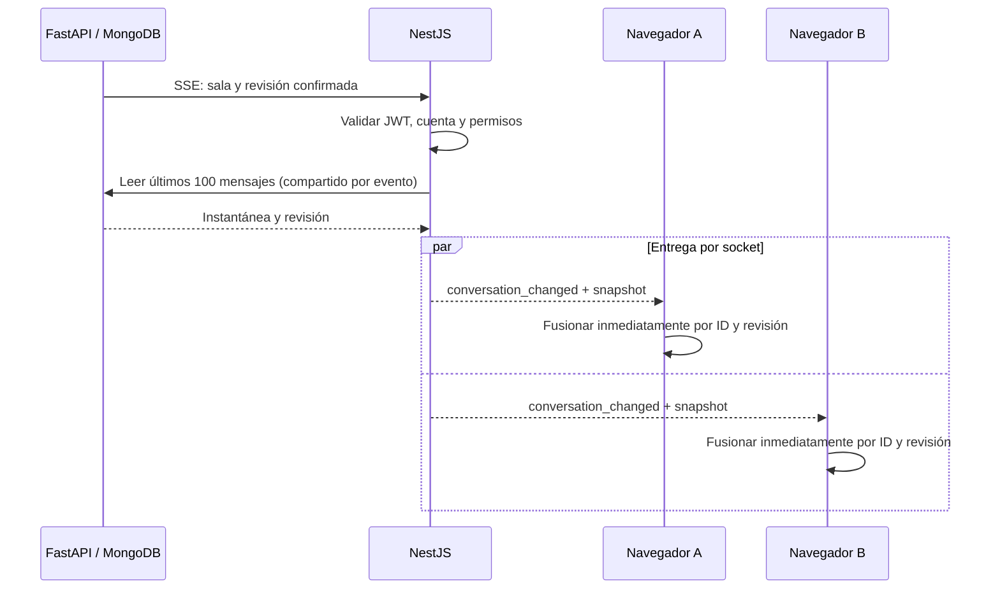

# Kanon: entrega de mensajes y audio sincronizado

## Objetivo y resultado

Reducir la diferencia de entrega entre participantes y consolidar la identidad vocal de Kanon.
El camino anterior enviaba una revisión por socket y cada navegador esperaba su temporizador,
autorización y lectura HTTP independientes. Una pestaña oculta suspendía esa lectura. Además,
la autorización cargaba el AST completo y la llamada podía lanzar consultas de historial solapadas.
Estos mecanismos podían producir diferencias observables; no se dispone de un perfil de la
sesión original de Firefox/Vivaldi que atribuya exactamente sus 5–10 segundos a uno de ellos.

Ahora el servidor comparte una lectura del historial por aviso entre sus destinatarios y envía
la instantánea directamente por Socket.IO. El cliente aplica el contenido sin esperar a un
intervalo, incluso si la pestaña está oculta y el navegador continúa ejecutándola. Se conserva
la autorización vigente y el aislamiento de chats personales por usuario.



## Contratos y recuperación

- `conversation_changed`: `{diagramId, scope, revision, snapshot?}`; `snapshot` contiene
  `{revision, messages, hasMore}`. El ámbito de un cambio grupal es explícito (`group`).
- NestJS usa lecturas de metadatos de diagrama/proyecto para comprobar acceso sin cargar el grafo.
  Se mantienen los mismos roles, creador y pertenencia vigentes. No hay caché permanente de permisos.
- Una lectura interna fallida conserva el aviso de revisión; el cliente puede recuperar por REST.
- El REST inicial, la paginación y el respaldo de 30 segundos permanecen. En el panel, el respaldo
  se pausa al ocultar la pestaña y se recupera al volver; los mensajes push no esperan ese ciclo.
- Las revisiones antiguas HTTP/socket no sobrescriben un snapshot más reciente. Un ACK tardío
  de envío no devuelve a `queued` un mensaje que ya llegó confirmado por socket.
- La llamada comparte el socket, consume snapshots sin otra lectura por aviso y serializa su
  respaldo HTTP; colgar cancela suscripciones y temporizadores.
- Los eventos SSE siguen siendo efímeros y locales al proceso FastAPI. Para varios workers o
  réplicas se requiere un bus compartido o Change Streams; este cambio no añade esa infraestructura.
- Los tiempos de red, autorización y suspensión de navegadores impiden prometer simultaneidad
  exacta. Tampoco se sincronizan relojes de reproducción entre dispositivos.

## Voz y controles

Kanon usa exclusivamente **Marcelo (`es-BO-MarceloNeural`)**. El selector de voces desaparece;
los contratos rechazan `sofia` u otras voces. La caché `v2` evita reutilizar audio antiguo sin
alineación y conserva audio más marcas fuera del historial, con el TTL configurado.

El altavoz está habilitado inicialmente y alterna entre escuchar y silenciar. Silenciar detiene
la descarga/reproducción y descarta la cola; las respuestas recibidas mientras está apagado no
se reproducen al reactivarlo. También silencia el audio remoto de la llamada. La preferencia
se conserva al cambiar de diagrama durante la sesión.

El micrófono de una llamada entra habilitado después de la acción de unirse y del permiso del
navegador; su botón activa/desactiva la pista real y la transcripción. Abrir el chat no captura
sonido. Fuera de la llamada, el botón sigue iniciando/deteniendo una nota de voz explícita.
El consentimiento para enviar intervenciones a Kanon sigue siendo individual y revocable.

Las ondas circulares indican grabación, actividad de voz, envío de un segmento o reproducción.
Se dibujan sobre los controles existentes, sin reducir el lienzo, y respetan `prefers-reduced-motion`.
La transcripción local hacia Kanon se pausa durante su respuesta hablada para reducir realimentación;
no constituye cancelación acústica garantizada de otros dispositivos.

Se corrigió la señalización WebRTC para usar el contrato `type: offer | answer | ice` y `data`
en ambos extremos. El alta de una llamada sobre un socket ya conectado se difiere una microtarea
para que exista su manejador antes de enviar `call_join`.

## Sincronización de texto y audio

`POST /api/conversations/:diagramId/messages/:messageId/speech-playback?scope=personal`
(el ámbito se omite para el grupo) acepta `{"voice":"marcelo"}` o `{}`. El puente llama a
la ruta interna equivalente con token de servicio. Devuelve el paquete dentro de la envoltura
JSON habitual de NestJS:

```json
{
  "audioBase64": "...",
  "mimeType": "audio/mpeg",
  "cues": [{"startMs": 500, "endMs": 1300, "text": "Hola equipo."}]
}
```

Edge TTS proporciona `SentenceBoundary` con offset/duración en unidades de 100 ns; el adaptador
los convierte a milisegundos. `ChatSpeechService` compara esas marcas con `audio.currentTime`
y muestra la frase actual como subtítulo. La alineación sigue pausas y cambios de posición;
no estima duración contando caracteres. Una respuesta sin marcas sigue siendo audible.
El texto completo permanece visible desde su recepción; no se oculta ni se demora para esperar
la síntesis. Se conserva la ruta binaria `/speech`, reutilizando el mismo audio cacheado.

La generación continúa por turnos: termina la respuesta textual, se sintetiza el audio completo
y empieza la reproducción. No es streaming LLM/TTS ni karaoke palabra por palabra. La reproducción
automática sigue siendo selectiva (participante en llamada grupal o autor de una consulta de voz);
fuera de esos casos se usa «Escuchar respuesta». Las restricciones de autoplay del navegador
pueden exigir ese clic incluso con el altavoz habilitado.

## ¿Llamar directamente a Kanon?

Es viable añadir una sesión privada de voz con Kanon usando la cadena actual de transcripción,
modelo y Marcelo; conserva el historial y la identidad boliviana, con latencia por turnos.
Para conversación bidireccional de menor latencia, [Gemini Live API](https://docs.cloud.google.com/vertex-ai/generative-ai/docs/live-api)
procesa audio continuo y produce audio nativo. Requeriría un adaptador y gestión de sesiones,
interrupciones, cuotas, permisos y recuperación; sus voces son propias de Google, no Marcelo de
Edge TTS. No se añadió una sesión Gemini Live ni una llamada privada nueva en este incremento.
La llamada grupal existente puede usarse estando solo, mencionando a Kanon; continúa siendo grupal.

## Verificación y operación

Resultados ejecutados en este incremento:

| Verificación | Resultado |
| --- | --- |
| Frontend: `npm test -- --watch=false` | 30 suites, 183 pruebas aprobadas; comprobaciones de arquitectura sin violaciones. |
| Frontend: `npm run build` | Compilación de producción correcta, sin advertencias. |
| Backend: `npm test -- --runInBand` | 26 suites, 211 pruebas aprobadas; tres WARN esperados del test de reconexión. |
| Backend: `npm run build` | Compilación correcta. |
| IA: `UV_CACHE_DIR=/tmp/uml-uv-cache uv run pytest -q` | 71 pruebas aprobadas; 65 avisos de deprecación de Google GenAI/MongoMock. |
| Transporte local HTTP + SSE + Socket.IO | Dos clientes reciben la misma respuesta con diferencia observada de **0,079 ms**; otra sala y JWT inválido permanecen aislados. |
| Edge TTS real, texto sintético | Marcelo disponible; MPEG de 26 784 bytes y una marca de frase. |

La prueba de transporte usa MongoMock y un generador sintético, con servidores y sockets reales;
**no es una medición de renderizado en Firefox/Vivaldi ni una garantía de latencia en producción**.
La prueba Edge sí contacta al proveedor, sin datos del usuario. No se probaron llamadas reales
entre navegadores, dispositivos de captura, TURN ni inferencias cloud en este incremento.

Reiniciar FastAPI y NestJS y recargar ambos navegadores después de actualizar los tres servicios.
No se requieren variables de entorno nuevas ni migración SQL. Para comparar manualmente:

1. Abrir el mismo chat grupal con dos cuentas autorizadas, una en cada navegador.
2. Enviar texto y luego `@Kanon` con una consulta; comprobar el mensaje y respuesta en ambos.
3. En Network, verificar que los avisos llevan `snapshot` y no disparan un GET por participante.
4. Ocultar una pestaña, volver, probar reconexión y verificar aislamiento del chat Personal.
5. Unirse a llamada, alternar micrófono/altavoz y comprobar subtítulos y ondas; colgar libera el micrófono.

Ver las guías de [Angular](../../../frontend/guia-desarrollador/README.md),
[NestJS](../../../backend/guia-desarrollador/README.md) y [FastAPI](../../guia-desarrollador/README.md).
