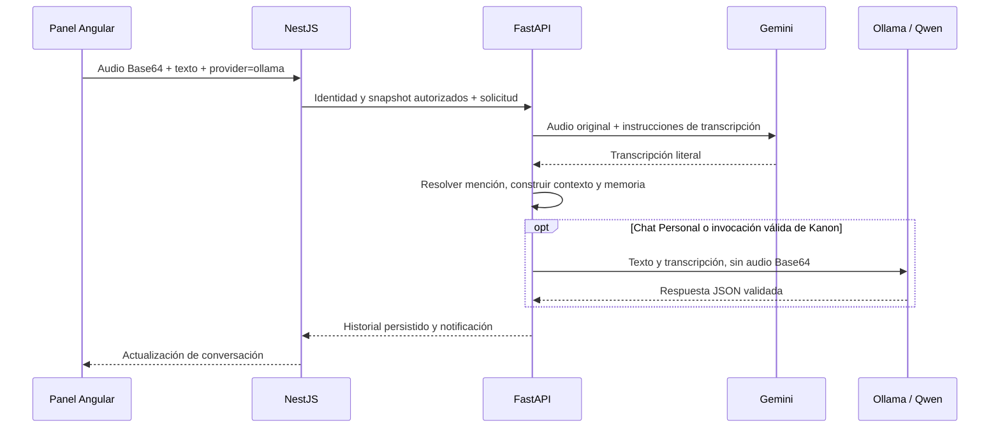

# Migración del proveedor local a Qwen3.8

## Objetivo y alcance

El proveedor `ollama` usa `qwen3.8:latest` como modelo predeterminado. El identificador
corresponde al servidor configurado por el usuario; el servicio no descarga modelos ni
verifica su existencia en un registro público.

El chat conserva el modelo seleccionado al enviar adjuntos. La implementación está en
[ModelProviders](../../app/providers/models.py), [ConversationService](../../app/conversations.py)
y el [panel Angular](../../../frontend/src/app/plugins/ai-assistant/ai-assistant-panel/ai-assistant-panel.component.ts).

## Flujos

| Entrada | Selección Qwen | Selección Gemini |
| --- | --- | --- |
| Texto | Ollama: contexto y texto con respuesta `ModelReply`. | Google: contexto y texto. |
| Imagen con invocación | Ollama: Base64 original en `messages[].images`, contexto y esquema `MultimodalReply`. | Google: medio original y contexto. |
| Imagen grupal sin invocación | Ollama describe la imagen para el historial, sin respuesta de Kanon. | Google describe la imagen para el historial. |
| Clip de audio | Gemini transcribe; Qwen recibe texto, contexto y transcripción si corresponde responder. | Medio original para responder; transcripción previa solo si hace falta detectar la invocación. |
| Llamada Live | Continúa en Gemini Live. | Continúa en Gemini Live. |



El clip sigue siendo un adjunto Base64 entre navegador, NestJS y FastAPI. Solo el tramo
FastAPI → Ollama se convierte a texto. Google continúa siendo necesario para la transcripción;
este flujo de audio no es completamente local. Las imágenes destinadas a Ollama no pasan
por Google. Si Ollama está detrás de un túnel remoto, los datos viajan a ese servidor.

Las menciones escritas y habladas, permisos, identificadores, leases, reintentos y propuestas
se mantienen. Una imagen usa `mediaProvider=ollama`; un audio transcrito usa
`mediaProvider=vertex`, mientras `provider=ollama` identifica al modelo que responde.
La memoria se resume con el proveedor seleccionado. No se cambia de proveedor tras un error.

## Configuración

En `ia/.env`, sin trasladar credenciales a NestJS o Angular:

```dotenv
OLLAMA_BASE_URL=https://your-ollama-tunnel.example
CHAT_OLLAMA_MODEL=qwen3.8:latest
CHAT_DEFAULT_PROVIDER=ollama
CHAT_MEDIA_PROVIDER=vertex
```

La URL es la base, sin `/api/chat`. El cliente HTTP añade `ngrok-skip-browser-warning: true`
a todas las peticiones Ollama, incluyendo `/api/tags`. El catálogo consulta ese endpoint
con timeout de tres segundos y comprueba el nombre exacto del modelo. No ejecuta inferencia.
Anuncia texto e imagen nativos y `audioVia=vertex`; el campo raíz `mediaProvider` conserva
su valor `vertex` por compatibilidad y se refiere al transcriptor.

Reiniciar FastAPI tras modificar `.env` y recargar el frontend para usar el nuevo código y
renovar el catálogo. La recarga de Uvicorn no garantiza detectar cambios del archivo `.env`.

## Verificación

- FastAPI: `uv run pytest -q`, **107 pruebas aprobadas**. Se probaron imágenes Base64,
  transcripción única por intento, contexto sin audio binario, selección del proveedor,
  menciones, idempotencia y fallo de transcripción. Son pruebas con dobles, sin inferencia real.
- Frontend: `npm test -- --watch=false`, **39 suites y 253 pruebas aprobadas**, incluyendo
  selección de Ollama al enviar imagen o audio. Hooks de arquitectura aprobados.
- Backend: `npm test -- --runInBand`, **31 suites y 243 pruebas aprobadas**; el puente
  conserva sus contratos de envío y delega el catálogo sin interpretar capacidades.
- Compilaciones de producción: `npm run build` aprobado en Angular y NestJS, sin errores
  ni advertencias de compilación.
- Advertencias de pruebas: deprecaciones de `google-genai` y `mongomock` en Python 3.14;
  tres avisos de reconexión esperados del doble de eventos en NestJS.

Se intentó una petición sintética `POST /api/chat` y una consulta `GET /api/tags` al túnel
proporcionado. Ambos respondieron HTTP 404; ngrok indicó **ERR_NGROK_3200, endpoint offline**.
No se pudo comprobar una inferencia real ni confirmar la capacidad visual del modelo servido.
Levantar el túnel y comprobar su catálogo permite completar esa validación operativa.

Ver también la [guía de proveedores](../../guia-desarrollador/04-PROVEEDORES-Y-ENTRADAS-MULTIMODALES.md).

## Seguimiento operativo

Posteriormente se comprobó el servidor activo y se reprodujo un fallo por tiempo de espera.
La generación con `think: false` respondió HTTP 200 y pasó la validación del contrato.
El detalle y los límites de esa prueba están en [Diagnóstico de timeout](TIMEOUT-DIAGNOSIS.md).
Esta prueba fue textual sobre un snapshot UML; no certifica todavía la calidad visual del modelo.
