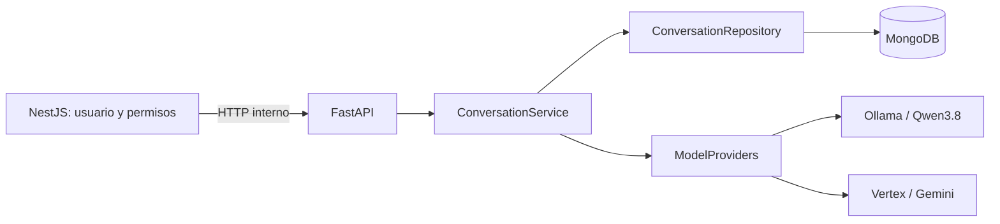

# 00 — Arquitectura y configuración

[Volver al índice](README.md)



[create_app](../app/main.py) construye la aplicación sin conectar servicios al importar el módulo.
Su lifespan abre MongoDB y proveedores, inicia el worker y cierra recursos al detenerse.
MongoDB debe responder durante el arranque. El worker delega operaciones bloqueantes a hilos.

## Propiedad del entorno

[Settings](../app/config.py) lee `ia/.env` por una ruta absoluta relativa al paquete, sin depender
del directorio de ejecución. Las variables del proceso prevalecen. No lee `backend/.env`.

| Variable | Valor predeterminado o propósito |
| --- | --- |
| `AI_SERVICE_TOKEN` | Obligatorio: token interno, distinto del JWT. |
| `MONGODB_URI` | `mongodb://127.0.0.1:27017/uml_studio_db`; configurar autenticación en el entorno real. |
| `MONGODB_DATABASE` | `uml_studio_db`. |
| `OLLAMA_BASE_URL` | `http://127.0.0.1:11434`. |
| `CHAT_OLLAMA_MODEL` | `qwen3.8:latest`. |
| `CHAT_DEFAULT_PROVIDER` | `ollama`; valores admitidos: `ollama`, `vertex`. |
| `AI_PROVIDER` | Alias de compatibilidad usado si falta `CHAT_DEFAULT_PROVIDER`. |
| `GEMINI_MODEL` | `gemini-2.5-flash`. |
| `GEMINI_API_KEY` | Credencial Google, solo en FastAPI. |
| `GCP_PROJECT_ID`, `GCP_LOCATION` | Proyecto autorizado y ubicación; región predeterminada `us-central1`. |
| `CHAT_MEDIA_PROVIDER` | `vertex`, para transcripción de audio. Las imágenes usan el proveedor seleccionado. |
| `CHAT_TIMEOUT_SECONDS` | 300 por solicitud al proveedor, entre 5 y 600. |
| `CHAT_CONTEXT_CHARS` | 48000 caracteres, entre 4000 y 100000. |
| `CHAT_RECENT_MESSAGES` | 12; ventana reciente entre 4 y 40 mensajes. |
| `CHAT_MEMORY_BATCH_MESSAGES` | 12; bloques resumidos entre 4 y 12 mensajes. |
| `CHAT_RETRIEVAL_MESSAGES` | 4; recuperación de 0 a 8 mensajes antiguos por consulta. |
| `CHAT_MEMORY_TIMEOUT_SECONDS` | 20; timeout del resumen entre 5 y 30 segundos. |

El valor predeterminado del código no equivale a la selección del `.env` local: puede elegirse
Vertex como proveedor inicial sin modificar Python. `OLLAMA_MODEL` no sustituye `CHAT_OLLAMA_MODEL`.
Mantener credenciales privadas fuera de documentación, payloads de ejemplo y logs.

## Arranque

```sh
uv sync
uv run uvicorn app.main:create_app --factory --host 127.0.0.1 --port 8000 --reload
```

Para ejecutar sin recarga, retirar `--reload`. Reiniciar Uvicorn después de cambiar `.env`;
la recarga de archivos Python no garantiza recargar configuración de entorno.

`compose.yaml` ofrece MongoDB de desarrollo; no provisiona automáticamente el usuario privado
de una instalación existente. No iniciar otra instancia sobre un puerto ya ocupado ni cambiar
la URI de una base real para hacer coincidir un ejemplo de esta guía.

El arranque no descarga ni carga Qwen por sí mismo. Para usarlo, preparar Ollama e instalar
el modelo visual bajo el identificador configurado; comprobarlo con `ollama list` en ese servidor.
`OLLAMA_BASE_URL` admite un servidor remoto HTTPS, sin el sufijo `/api/chat`.
