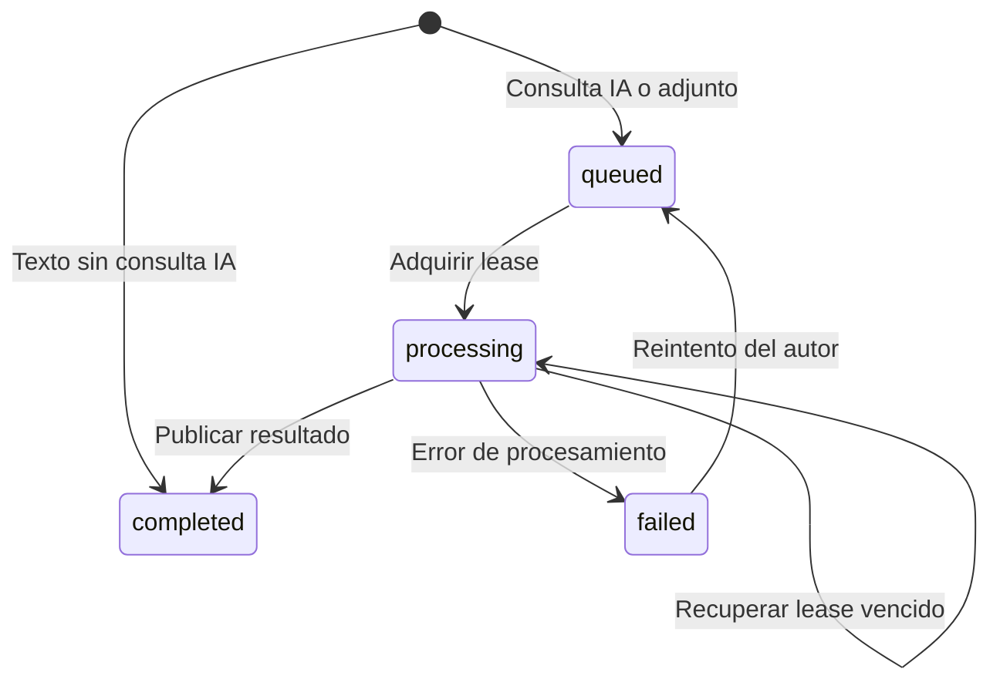
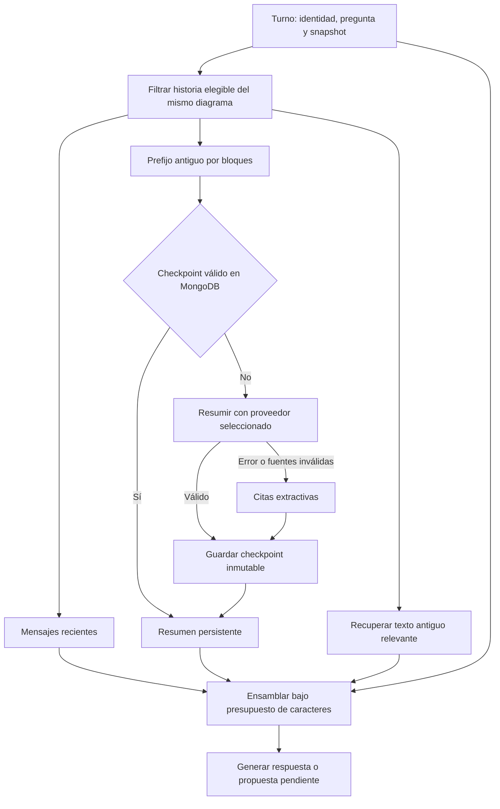

# 02 — Conversaciones, contexto y turnos

[Volver al índice](README.md)

## Una secuencia compartida

[ConversationService](../app/conversations.py) asigna secuencias de sala y conserva mensajes
humanos y respuestas del asistente en un único historial. El servidor ordena intervenciones;
la hora del cliente no determina el orden.

Un mensaje de texto con `askAssistant=false` se completa sin generar respuesta del modelo.
Los adjuntos sí pasan por descripción o transcripción para obtener contenido textual, incluso
cuando no se solicita una respuesta del asistente. Este procesamiento usa el proveedor de medios.

## Worker y concurrencia

El worker de [main.py](../app/main.py) consulta salas pendientes, espera 0,5 segundos entre
iteraciones y procesa hasta cuatro salas en paralelo por proceso. Dentro de una sala se
adquiere un lease de 300 segundos para el turno activo. No son cuatro turnos simultáneos de
la misma conversación ni una cola externa Celery.

La generación ocurre fuera de la petición de aceptación HTTP. Los participantes recuperan
respuestas por HTTP al recibir avisos Socket.IO de NestJS, con comprobación periódica de respaldo. No hay streaming de tokens ni canal de llamadas.
Los fallos se conservan como estado del mensaje y el autor puede solicitar reintento explícito.

## Contexto del mentor/modelador

[context.py](../app/context.py) combina snapshot autorizado, remitente y pregunta actual con
las tres capas administradas por [memory.py](../app/memory.py):

| Capa | Contenido | Comportamiento predeterminado |
| --- | --- | --- |
| `sharedHistory` | Mensajes recientes completados, con autor y secuencia. | Hasta 12 mensajes; extractos explícitos si falta espacio. |
| `conversationMemory` | Requisitos, decisiones, restricciones y preguntas abiertas resumidos. | Hasta 12 elementos de 240 caracteres con referencias a fuentes. |
| `retrievedHistory` | Mensajes antiguos relevantes para la consulta actual. | Hasta 4; búsqueda léxica local sin embeddings. |

### Elegibilidad y presupuesto

Se excluyen intervenciones humanas posteriores al turno y mensajes pendientes o fallidos.
Se admiten respuestas completadas a intervenciones previas mediante `replyTo`, aunque su
secuencia sea mayor. La misma selección se usa para resumen, recuperación y contexto reciente.
Las transcripciones y descripciones completadas participan como texto; no se vuelven a enviar
los binarios históricos. El texto entre personas también participa aunque no haya solicitado IA.

`CHAT_CONTEXT_CHARS` limita el **JSON completo** enviado para responder, no tokens ni el prompt
de sistema. Identidad, pregunta y snapshot se reservan íntegros; si no caben se rechaza el turno.
Del espacio restante se reserva inicialmente la mitad para mensajes recientes, un cuarto para
memoria y un cuarto para recuperación. El espacio sobrante admite otros mensajes de la ventana
reciente. Puede haber menos elementos que los máximos configurados si no caben sus metadatos.
Los mensajes recortados llevan `excerpted=true`; la versión original en MongoDB permanece intacta.
`individualMessageSequences` referencia hasta cuatro intervenciones incluidas del autor actual,
sin duplicar su texto. Las fuentes del resumen conservan identidad y secuencia.

### Actualización incremental

Con los valores predeterminados, la primera consulta con **24 mensajes anteriores elegibles**
resume los 12 más antiguos y conserva los últimos 12 como ventana reciente. Después solo se
actualiza al completar otro bloque antiguo de 12. No ocurre al abrir el panel, consultar el
catálogo, cargar historial o sintetizar audio. No hay inferencias periódicas de resumen.

Cada actualización hace como máximo **una solicitud adicional** al proveedor elegido para
el turno. Envía la memoria previa y hasta 12 mensajes con extractos de 800 caracteres. Ante
una conversación antigua sin checkpoints, los bloques iniciales se condensan mediante citas
y solo el último bloque se envía al modelo. Un fallo, JSON inválido o referencias desconocidas
produce memoria extractiva persistente, sin cambiar a otro proveedor ni abortar la respuesta.
Si falla la colección de memoria, se continúa con mensajes recientes y recuperación textual.

### Alcance y límites

El resumen es una ayuda con pérdida de información, no memoria perfecta ni una decisión
verificada. El prompt distingue propuestas del asistente, acuerdos humanos y conflictos; da
prioridad a correcciones recientes y al snapshot actual. NestJS sigue siendo el único que
valida permisos y aplica propuestas después de revisión humana.

La recuperación compara palabras sin distinguir tildes ni mayúsculas, elimina palabras comunes
y pondera términos poco frecuentes. No comprende sinónimos ni referencias vagas como «lo que
hablamos al principio» si no contienen términos útiles. Los cambios de opinión pueden requerir
aclaración humana. Se consulta únicamente el historial de la sala autorizada, sin base vectorial
ni descarga de modelos. El historial continúa sujeto a sus límites existentes de capacidad.

Ver [reporte y operación](../docs/conversation-memory/README.md).
