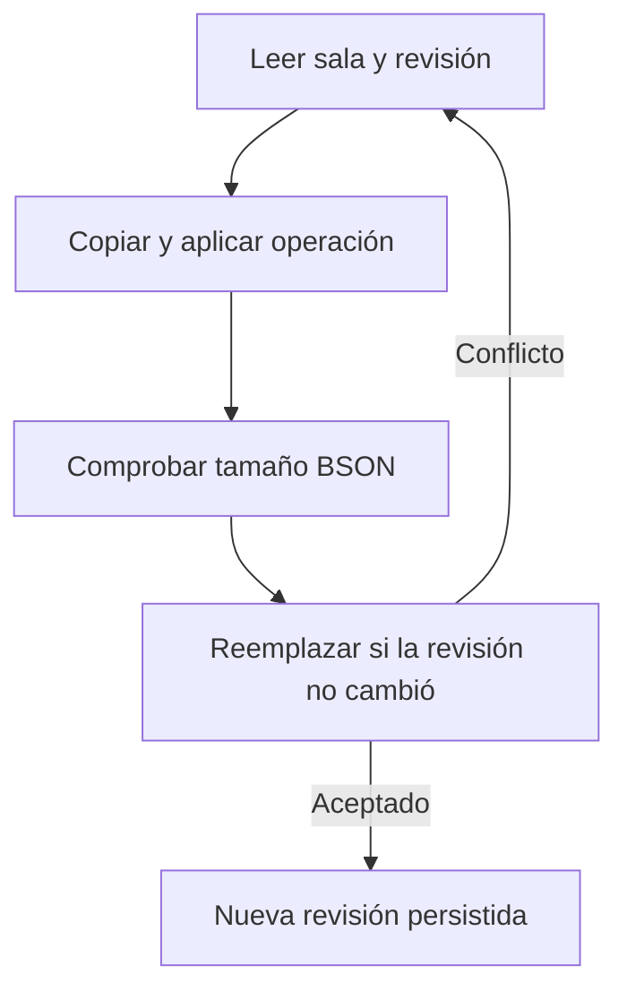

# 03 — Persistencia MongoDB y recuperación

[Volver al índice](README.md)

## Colecciones

| Colección | Contenido |
| --- | --- |
| `conversation_sessions` | `_id` de sala, revisión, siguiente secuencia, mensajes y propuestas compactos. |
| `ai_requests` | Payload original, snapshot, adjunto y datos necesarios para recuperar el procesamiento. |
| `conversation_memory` | Checkpoints derivados e inmutables con resumen, fuentes, proveedor y método. |
| `conversation_speech` | Variantes privadas de audio generado con TTL. |

[repository.py](../app/repository.py) mantiene ambas colecciones. El ID del mensaje deriva de
sala, autor y `clientMessageId`; reutilizar esos datos devuelve la intervención existente.
La respuesta tiene un identificador derivado del mensaje, para impedir publicación duplicada.

## Escritura con comparación de revisión

El repositorio vuelve a intentar conflictos de revisión hasta su límite configurado en código
(actualmente 30 intentos). Una operación sin cambios evita una escritura. La unicidad de `_id`
resuelve carreras al crear una sala. No reemplazar esta operación por un `read`/`save` sin condición.

El historial y las propuestas se modifican atómicamente dentro de un documento de sala.
La solicitud original se almacena por separado con semántica de inserción si no existe.
No hay transacción MongoDB multidocumento: una solicitud huérfana sin mensaje aceptado no
es trabajo pendiente y el worker no la procesa.

## Lease y recuperación

La revisión CAS protege la adquisición del turno. El lease lleva token y vencimiento; al
publicar, el servicio comprueba que ese token sigue siendo el propietario del turno.
Un reinicio permite recuperar leases vencidos. Un proceso antiguo que termina tarde no debe
publicar sobre el resultado de un nuevo propietario.

Esta protección evita duplicar la publicación, pero no garantiza una sola invocación o un
solo cobro del proveedor si el proceso cae durante inferencia. No describirla como ejecución
exactamente una vez del modelo.

## Capacidad y conservación

- Hasta 20 turnos pendientes por sala.
- Historial cercano a 1000 mensajes, con reserva para respuestas pendientes.
- Documento de sala acotado a 12 MB; páginas de hasta 100 mensajes.
- Adjuntos de hasta 5 MB en solicitudes, separados del historial compacto.

No hay archivado ni eliminación automática del historial o de adjuntos originales. Solo la
caché de audio generado tiene TTL; los checkpoints de memoria no caducan automáticamente. Diseñar una
política de retención explícita antes de ampliar el uso; no borrar solicitudes activas para
reducir tamaño sin conservar la capacidad de recuperación.

## Checkpoints de memoria

[MemoryRepository](../app/memory.py) escribe `conversation_memory` mediante `$setOnInsert`.
Cada clave SHA-256 incorpora versión del algoritmo, sala, tamaño de bloque y contenido,
autoría, ID y secuencia del prefijo elegible. La lectura busca únicamente hashes calculados
para el turno actual; no usa una referencia global al «último resumen» de la sala.

Esto impide que un reintento antiguo lea memoria de mensajes humanos futuros. Si aparece una
respuesta tardía o cambia una transcripción, los prefijos afectados tienen otros hashes y se
reconstruyen cuando se necesiten. Un worker tardío no sobrescribe un checkpoint ya publicado.
Puede repetirse la inferencia tras una caída o carrera, pero la primera inserción prevalece.

Los checkpoints almacenan `roomId`, `messageCount`, `throughSequence`, `items`, `method`,
`provider` y `createdAt`. `throughSequence` es descriptivo: **no determina por sí solo** qué
mensajes se admiten. `method` distingue `model` de `extractive`. Las referencias de cada
resumen deben pertenecer al bloque suministrado o a las fuentes de memoria previa.

Crear memoria no modifica revisión, mensajes, IDs, propuestas ni solicitudes del usuario.
No hay migración destructiva ni cambio del contrato HTTP. MongoDB crea la nueva colección al
primer checkpoint y usa su índice `_id`; se requieren permisos de lectura e inserción/actualización.
Las colecciones y checkpoints son internos; no se exponen por un endpoint al navegador.
La caché puede reconstruirse desde el historial y no sustituye su conservación.

## Avisos posteriores al commit

`ConversationRepository` admite un observador `on_changed`, compuesto por `main.py` con
`ConversationEvents.publish`. Se invoca después de insertar/reemplazar correctamente la sala,
con ID y revisión confirmados. Las lecturas y mutaciones sin cambios no emiten avisos.
La inserción de solicitudes, memoria y caché de voz tampoco publica cambios de historial.

Esto cubre mensajes humanos, adquisición/finalización de turnos, fallos, reintentos y aplicación
de propuestas. Un error al notificar se aísla y no transforma un commit exitoso en un fallo de
la operación. El respaldo HTTP recupera cambios cuyo aviso se pierda. No hay una transacción
entre MongoDB y el flujo SSE ni una tabla/colección adicional de eventos.
