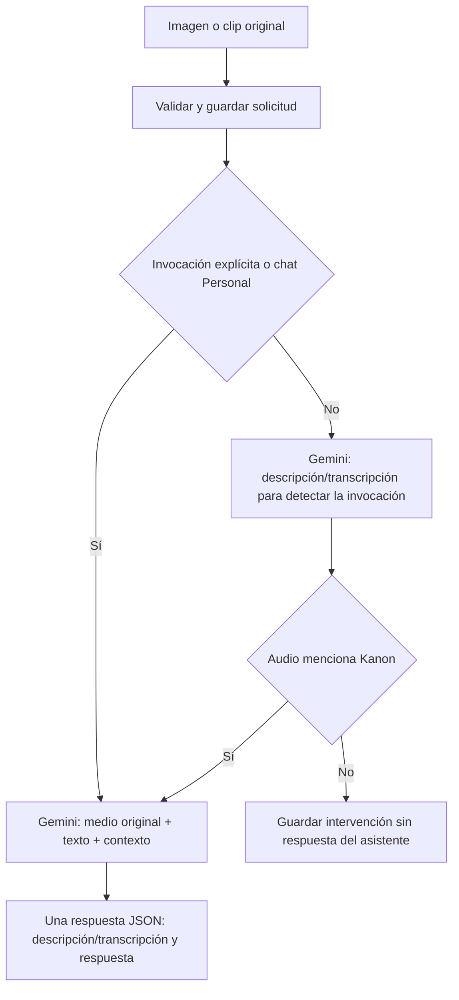

# 04 — Proveedores y entradas multimodales

[Volver al índice](README.md)

[ModelProviders](../app/providers/models.py) encapsula clientes, catálogo, generación,
descripción de medios y cierre de recursos. El caso de uso no construye peticiones Google
u Ollama por su cuenta.

## Modelos y catálogo

| Selección | Adaptador | Uso |
| --- | --- | --- |
| `ollama` | HTTP local `/api/chat` | Texto y modelado con `qwen2.5-coder:14b`. |
| `vertex` | Google Gen AI SDK | Generación cloud con `gemini-2.5-flash` por defecto. |
| Medios | Google Gen AI SDK | Interpretación del adjunto original, transcripción/descripción y respuesta con Gemini. |
| Llamada | Google Gen AI Live | Audio nativo bidireccional con transcripciones incrementales. |

El catálogo comprueba modelos de Ollama mediante `/api/tags` con espera acotada. La disponibilidad
cloud refleja configuración de credencial/proyecto; no constituye una prueba real de autorización,
cuota o respuesta. Consultar el catálogo no debe ejecutar una inferencia ni descargar Qwen.
No hay cambio silencioso a otro proveedor cuando falla el elegido.

## Autenticación Google

| Configuración | Comportamiento |
| --- | --- |
| Clave Vertex reconocida por prefijo `AQ.` y proyecto | Cliente Vertex regional con proyecto y ubicación explícitos. |
| Clave Vertex sin proyecto | Modo Express sin forzar ubicación regional. |
| Clave Gemini API | Cliente Gemini API; no tratarla como credencial regional de Vertex. |
| Sin API key | Cliente Vertex con proyecto/ubicación y credenciales ADC del entorno. |

Configurar `GEMINI_API_KEY`, `GCP_PROJECT_ID` y `GCP_LOCATION` juntos para la ruta regional
cuando corresponda. Omitir el proyecto en esa ruta produjo anteriormente `projects/None`.
Las claves reales solo deben existir en configuración privada; no copiarlas a tests o comandos compartidos.

## Texto, imagen y voz

La generación pide JSON conforme a `ModelReply` y valida la respuesta antes de publicarla.
Para Ollama se envía el esquema como formato; para Google se solicita JSON con instrucciones
estructuradas. La salida sigue siendo entrada no confiable hasta pasar validación.

Imágenes admitidas: PNG, JPEG y WebP. Audio: WebM, Ogg, WAV, MP4 y MPEG.
El MIME se normaliza retirando parámetros, por ejemplo el códec de una grabación WebM.
El adjunto se guarda de forma privada y NestJS autoriza su posterior descarga.

Los adjuntos usan Gemini incluso si el selector está en Qwen; se informa en la interfaz y el
servidor impone la misma regla. El proveedor efectivo del mensaje es `vertex`; el payload
original conserva la selección para verificar idempotencia. Las consultas de solo texto
continúan usando el proveedor seleccionado.

En Personal o con `@Kanon` escrito junto al clip, `generate_multimodal` envía los bytes originales,
el texto adjunto y el contexto autorizado en **una inferencia de contenido**. `MultimodalReply`
valida `description` y `reply`. No hay transcripción previa para averiguar si se invocó a Kanon.
La memoria histórica puede requerir su propia actualización por bloques, como en cualquier turno.

En Grupal, un clip sin mención escrita todavía necesita transcripción para decidir si contiene
«Kanon». Si lo invoca, la respuesta también usa el audio original, sin reducirlo a la transcripción.
Una imagen sin invocación en Grupal se describe para el historial pero no solicita respuesta.
No hay fallback de medios hacia Qwen. Los límites de MIME, tamaño y duración del frontend permanecen.

## Transcripción literal con vocabulario

Para audio, el adaptador usa instrucciones específicas, temperatura cero y nombres del snapshot
autorizado como pistas acotadas. `app/transcription.py` excluye notas y campos privados del glosario.
No se sustituye la transcripción por una frase esperada: lo escuchado tiene prioridad y se pide
marcar fragmentos ininteligibles. Una salida mayor de 16000 caracteres se rechaza sin truncarla.
La detección de Kanon conserva las variantes habladas `Kanon`, `Canon` y `Kannon`.

Las llamadas actuales usan transcripción nativa de Gemini Live; no usan reconocimiento de voz del navegador.
Ver [reporte y límites de la mejora](../docs/audio-transcription/README.md).

## Síntesis opcional de respuestas

[SpeechService](../app/speech.py) toma únicamente respuestas de asistente completadas del
historial de la sala. [EdgeSpeechProvider](../app/providers/edge_speech.py) implementa el puerto
`SpeechProvider` con `edge-tts`; no conoce permisos, historial ni propuestas. El texto sintetizado
se envía al servicio remoto de Microsoft aunque el modelo elegido para generar sea Qwen local.

La voz fija es `marcelo` → `es-BO-MarceloNeural`; otros valores se rechazan. Se omiten bloques
de código y marcas de presentación al leer; no se altera el texto guardado ni se lee el AST.
La síntesis no ocurre durante la generación LLM: un participante la solicita al escuchar una
respuesta o al activar reproducción de respuestas nuevas. El texto no espera al audio.

La colección `conversation_speech` contiene variantes privadas con TTL (7 días por defecto).
Su clave incorpora sala, mensaje, voz y hash del texto. El historial no contiene binarios nuevos.
Se comparte una síntesis en curso entre peticiones del mismo proceso; entre procesos puede
haber trabajo duplicado antes de que la caché esté disponible. El límite de concurrencia también
es por proceso. Fallos se responden sin detalles del proveedor y no reintentan la inferencia LLM.

El adaptador de voz reintenta una vez los fallos transitorios, con buffers independientes y
pausa de 0,5 segundos, dentro del mismo plazo global. La conexión se acota a 5 segundos y
la inactividad de lectura a 10 segundos. Cancelaciones y errores no transitorios se propagan.
El log `Speech unavailable` identifica etapa y clase de excepción sin imprimir su contenido.
Ver [diagnóstico y recuperación de audio](../docs/voice-mode/SPEECH-RECOVERY.md).

Límites configurables en `ia/.env`: `SPEECH_TIMEOUT_SECONDS` (30, máximo 35),
`SPEECH_MAX_CHARS` (12000), `SPEECH_MAX_CONCURRENT` (2) y `SPEECH_CACHE_DAYS` (7).
El audio se limita a 5 MB. Un texto demasiado largo devuelve 422 y permanece legible completo;
no se recorta silenciosamente. Sin capacidad devuelve 429, sin síntesis disponible 503.
Ver [operación y reporte del modo voz](../docs/voice-mode/README.md).

## Resumen incremental de conversación

`ModelProviders.summarize` usa el mismo proveedor seleccionado para responder: Ollama local o
Google configurado. Solicita `MemorySummary` con esquema JSON estricto, sin campo AST ni
herramientas. La respuesta se valida con Pydantic y sus referencias se comprueban en la capa
de memoria. Un JSON correcto no garantiza exactitud semántica; el resumen sigue siendo dato
no confiable y derivado.

La llamada adicional ocurre solo al completar un bloque antiguo nuevo. Usa timeout propio
(`CHAT_MEMORY_TIMEOUT_SECONDS`, 20 segundos por defecto), temperatura cero y límite de salida
(2048 tokens en Ollama; 4096 en Google). Google desactiva reintentos SDK para esta operación.
Los timeouts HTTP no representan una garantía absoluta de duración total ante todas las
condiciones de transporte; el token de lease sigue protegiendo la publicación de resultados.
Un fallo conserva citas extractivas y continúa con la generación normal; no cambia proveedor.
El consumo de tokens mostrado en la respuesta corresponde a la generación final, **no incluye**
el resumen adicional. Este último puede consumir cuota cloud y añadir latencia o trabajo local.
Al cambiar de proveedor se conserva la memoria compartida de la sala, no se crea otro historial.

## Audio alineado de Kanon

La ruta autenticada `POST /internal/conversations/{room_id}/messages/{message_id}/speech-playback`
acepta la misma voz fija y devuelve `{audioBase64, mimeType, cues}`. Cada cue tiene `startMs`,
`endMs` y `text`: marcas `SentenceBoundary` reales de Edge TTS convertidas a milisegundos.
La caché `v2` guarda audio y marcas juntos; `/speech` reutiliza su audio. No se espera a la síntesis
para publicar texto ni se modifica el historial. Ver [contratos y reporte](../docs/kanon-realtime/README.md).

## Llamada nativa con Gemini Live

`app/live.py` usa el mismo cliente Google y la misma `GEMINI_API_KEY` privada del chat.
El modelo predeterminado es `gemini-3.8-live` (con respaldo a `gemini-live-2.5-flash-native-audio`); no se reutiliza el modelo
HTTP `gemini-2.5-flash` como si fuera compatible con Live.

El micrófono autorizado envía PCM mono de 16 bits a 16 kHz. Gemini devuelve PCM a 24 kHz y
transcripciones de entrada/salida. La voz fija es **Puck**; la voz boliviana **Marcelo** sigue
perteneciendo a Edge TTS para respuestas de clips/chat. No existe selector de voz.

Los turnos Live se guardan en el historial grupal con `speechMode: live`; el frontend evita
volver a sintetizarlos con Edge TTS. Live no ejecuta herramientas ni aplica cambios al AST.
Ver [arquitectura, operación, verificación y límites](../docs/gemini-live/README.md).
