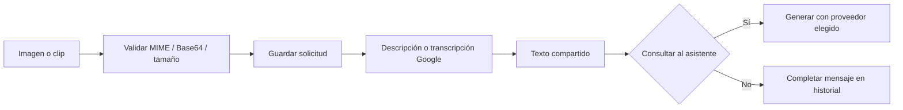

# 04 — Proveedores y entradas multimodales

[Volver al índice](README.md)

[ModelProviders](../app/providers/models.py) encapsula clientes, catálogo, generación,
descripción de medios y cierre de recursos. El caso de uso no construye peticiones Google
u Ollama por su cuenta.

## Modelos y catálogo

| Selección | Adaptador | Uso |
| --- | --- | --- |
| `ollama` | HTTP local `/api/chat` | Texto y modelado con `qwen2.5-coder:14b`. |
| `vertex` | Google Gen AI SDK | Generación cloud con `gemini-2.5-flash` por defecto. |
| Medios | Google Gen AI SDK | Transcripción de clips y descripción de imágenes. |

El catálogo comprueba modelos de Ollama mediante `/api/tags` con espera acotada. La disponibilidad
cloud refleja configuración de credencial/proyecto; no constituye una prueba real de autorización,
cuota o respuesta. Consultar el catálogo no debe ejecutar una inferencia ni descargar Qwen.
No hay cambio silencioso a otro proveedor cuando falla el elegido.

## Autenticación Google

| Configuración | Comportamiento |
| --- | --- |
| Clave Vertex reconocida por prefijo `AQ.` y proyecto | Cliente Vertex regional con proyecto y ubicación explícitos. |
| Clave Vertex sin proyecto | Modo Express sin forzar ubicación regional. |
| Clave Gemini API | Cliente Gemini API; no tratarla como credencial regional de Vertex. |
| Sin API key | Cliente Vertex con proyecto/ubicación y credenciales ADC del entorno. |

Configurar `GEMINI_API_KEY`, `GCP_PROJECT_ID` y `GCP_LOCATION` juntos para la ruta regional
cuando corresponda. Omitir el proyecto en esa ruta produjo anteriormente `projects/None`.
Las claves reales solo deben existir en configuración privada; no copiarlas a tests o comandos compartidos.

## Texto, imagen y voz

La generación pide JSON conforme a `ModelReply` y valida la respuesta antes de publicarla.
Para Ollama se envía el esquema como formato; para Google se solicita JSON con instrucciones
estructuradas. La salida sigue siendo entrada no confiable hasta pasar validación.

Imágenes admitidas: PNG, JPEG y WebP. Audio: WebM, Ogg, WAV, MP4 y MPEG.
El MIME se normaliza retirando parámetros, por ejemplo el códec de una grabación WebM.
El adjunto se guarda de forma privada y NestJS autoriza su posterior descarga.

Elegir Qwen para generar texto no hace local el procesamiento de una imagen o clip: los medios
usan Google. La grabación del frontend tiene su propio límite de duración; el servidor valida
tamaño y MIME, no duración real. La voz de salida usa un adaptador independiente descrito a continuación; no es una llamada continua.

## Síntesis opcional de respuestas

[SpeechService](../app/speech.py) toma únicamente respuestas de asistente completadas del
historial de la sala. [EdgeSpeechProvider](../app/providers/edge_speech.py) implementa el puerto
`SpeechProvider` con `edge-tts`; no conoce permisos, historial ni propuestas. El texto sintetizado
se envía al servicio remoto de Microsoft aunque el modelo elegido para generar sea Qwen local.

Las voces son `sofia` → `es-BO-SofiaNeural` y `marcelo` → `es-BO-MarceloNeural`. Se omiten bloques
de código y marcas de presentación al leer; no se altera el texto guardado ni se lee el AST.
La síntesis no ocurre durante la generación LLM: un participante la solicita al escuchar una
respuesta o al activar reproducción de respuestas nuevas. El texto no espera al audio.

La colección `conversation_speech` contiene variantes privadas con TTL (7 días por defecto).
Su clave incorpora sala, mensaje, voz y hash del texto. El historial no contiene binarios nuevos.
Se comparte una síntesis en curso entre peticiones del mismo proceso; entre procesos puede
haber trabajo duplicado antes de que la caché esté disponible. El límite de concurrencia también
es por proceso. Fallos se responden sin detalles del proveedor y no reintentan la inferencia LLM.

Límites configurables en `ia/.env`: `SPEECH_TIMEOUT_SECONDS` (30, máximo 35),
`SPEECH_MAX_CHARS` (12000), `SPEECH_MAX_CONCURRENT` (2) y `SPEECH_CACHE_DAYS` (7).
El audio se limita a 5 MB. Un texto demasiado largo devuelve 422 y permanece legible completo;
no se recorta silenciosamente. Sin capacidad devuelve 429, sin síntesis disponible 503.
Ver [operación y reporte del modo voz](../docs/voice-mode/README.md).

## Resumen incremental de conversación

`ModelProviders.summarize` usa el mismo proveedor seleccionado para responder: Ollama local o
Google configurado. Solicita `MemorySummary` con esquema JSON estricto, sin campo AST ni
herramientas. La respuesta se valida con Pydantic y sus referencias se comprueban en la capa
de memoria. Un JSON correcto no garantiza exactitud semántica; el resumen sigue siendo dato
no confiable y derivado.

La llamada adicional ocurre solo al completar un bloque antiguo nuevo. Usa timeout propio
(`CHAT_MEMORY_TIMEOUT_SECONDS`, 20 segundos por defecto), temperatura cero y límite de salida
(2048 tokens en Ollama; 4096 en Google). Google desactiva reintentos SDK para esta operación.
Los timeouts HTTP no representan una garantía absoluta de duración total ante todas las
condiciones de transporte; el token de lease sigue protegiendo la publicación de resultados.
Un fallo conserva citas extractivas y continúa con la generación normal; no cambia proveedor.
El consumo de tokens mostrado en la respuesta corresponde a la generación final, **no incluye**
el resumen adicional. Este último puede consumir cuota cloud y añadir latencia o trabajo local.
Al cambiar de proveedor se conserva la memoria compartida de la sala, no se crea otro historial.
