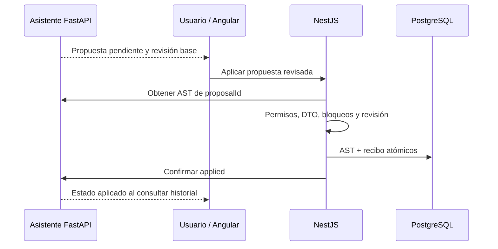

# 05 — Propuestas UML e integración con NestJS

[Volver al índice](README.md)

## Generar una propuesta no modifica el diagrama

`ModelReply` puede contener `proposedAst`. El servicio adjunta una propuesta pendiente a la
respuesta del asistente, incluyendo revisión base del documento. El panel permite inspeccionarla;
solo una acción del usuario llama al endpoint de aplicación en NestJS.

FastAPI no se conecta a PostgreSQL, no aplica permisos del editor y no ejecuta herramientas
que modifiquen el AST persistido. La confirmación `applied` debe proceder del backend después
de completar la operación autorizada.

## Contrato y normalización

[proposal_contract.py](../app/proposal_contract.py) convierte `sourceCardinality` y
`targetCardinality` a `sourceMultiplicity` y `targetMultiplicity`, respectivamente.
Trabaja sobre una copia y conserva los identificadores. Rechaza valores no textuales y
alias que contradigan los campos canónicos. No descarta propiedades desconocidas para
simular una validación correcta.

[ModelReply](../app/models.py) exige arrays de nodos y conexiones, IDs de nodo únicos,
referencias existentes, hasta 500 nodos y 2000 conexiones y tamaño serializado acotado.
Es validación estructural mínima; el DTO de NestJS contiene la validación autoritativa completa.
Un JSON aceptado aquí todavía puede ser rechazado al aplicar.

## Aplicación y recuperación

Un cambio posterior del diagrama puede invalidar la revisión base y producir `409`.
No actualizar esa revisión artificialmente para forzar una propuesta vieja.
Si el commit SQL terminó y falla la confirmación MongoDB, el recibo de NestJS permite
reintentar sin volver a modificar el documento. No existe transacción distribuida entre bases.

NestJS también normaliza los alias de propuestas históricas ya almacenadas. No es necesario
migrar manualmente esos mensajes para aplicar la corrección de multiplicidades.
Consultar el [contrato del backend](../../backend/guia-desarrollador/04-DIAGRAMAS-Y-PERSISTENCIA-AST.md)
y el [flujo de aplicación](../../backend/guia-desarrollador/06-ASISTENTE-INTELIGENCIA-ARTIFICIAL.md).
