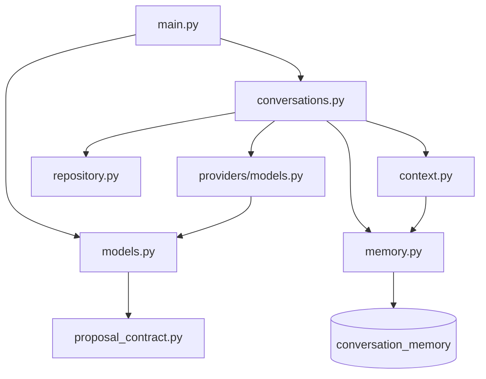

# 07 — Mapa de directorios y flujos

[Volver al índice](README.md)

| Ruta desde `ia/` | Responsabilidad |
| --- | --- |
| `app/main.py` | Factoría ASGI, rutas, autenticación interna, lifespan y worker. |
| `app/config.py` | Configuración y propiedad del entorno. |
| `app/events.py` | Difusión SSE interna, colas acotadas y avisos de resincronización. |
| `app/models.py` | Contratos Pydantic y validaciones de frontera. |
| `app/conversations.py` | Aceptación, secuencias, procesamiento, reintentos y propuestas. |
| `app/context.py` | Instrucciones y ensamblaje de contexto reciente, memoria y recuperación bajo presupuesto. |
| `app/memory.py` | Selección elegible, búsqueda léxica, resumen incremental y repositorio de checkpoints. |
| `app/repository.py` | MongoDB, solicitudes originales, CAS y búsqueda de salas pendientes. |
| `app/proposal_contract.py` | Normalización pura de multiplicidades. |
| `app/providers/models.py` | Adaptadores de modelos, catálogo, medios y cierre de clientes. |
| `tests/` | Pruebas de contratos y comportamiento con dependencias sustituidas. |
| `pyproject.toml`, `uv.lock` | Dependencias declaradas y resolución reproducible. |
| `compose.yaml` | MongoDB de desarrollo; no representa toda la plataforma. |
| `README.md`, `guia-desarrollador/` | Arranque y documentación detallada. |
| `.agents/skills/`, `AGENTS.md` | Reglas de contribución para agentes. |
| `.env`, `.venv/` | Configuración privada y entorno local; no son código de dominio. |

## Dependencias del caso de uso

Los módulos se reúnen en la factoría. Las pruebas pueden inyectar servicio/configuración
sin iniciar proveedores reales. La lógica de conversación no debe depender de objetos HTTP
de FastAPI ni de componentes Angular.

## Dónde agregar un cambio

| Necesidad | Punto de extensión |
| --- | --- |
| Nuevo campo del mensaje | Contrato Pydantic, puente NestJS y consumidor Angular coordinados. |
| Nueva regla de turno o recuperación | Caso de uso y operación atómica del repositorio. |
| Otra estrategia de contexto | `context.py` y `memory.py`, con pruebas de presupuesto, fuentes y orden temporal. |
| Nuevo proveedor | Adaptador, catálogo, configuración y pruebas; sin fallback implícito. |
| Compatibilidad de salida UML | Normalizador puro y DTO autoritativo de NestJS. |
| Otra persistencia | Frontera del repositorio; mantener idempotencia y concurrencia observables. |

Mantener alta cohesión y separar adaptadores cuando una nueva responsabilidad lo justifique.
No crear paquetes vacíos ni duplicar el esquema del documento dentro de prompts como única
fuente de verdad. La guía explica la organización actual, no afirma una interfaz abstracta
formal allí donde el código usa dependencias sustituibles por métodos compatibles.
